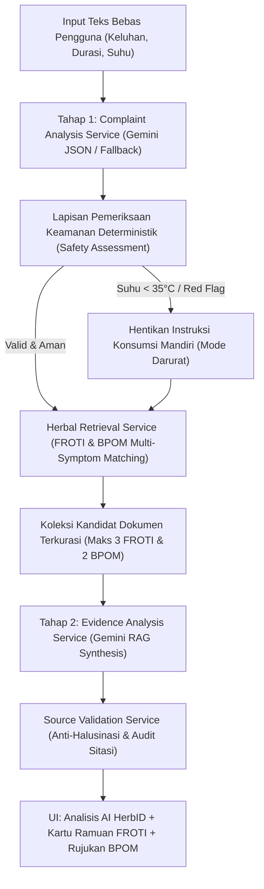

# HERB-INFO AI : Intelligent Symptom Understanding & Herbal Information Retrieval

**Judul Penelitian:** *Sistem Cerdas Pencarian Informasi Ramuan Obat Tradisional Indonesia Berdasarkan Keluhan Menggunakan Natural Language Processing (NLP), TF-IDF, dan Semantic Similarity*

Aplikasi web sistem temu kembali informasi (*information retrieval*) dan asisten cerdas ramuan obat tradisional Indonesia, memuat katalog 25 ramuan terkurasi (termasuk 19 ramuan resmi **Formularium Ramuan Obat Tradisional Indonesia / FROTI Kementerian Kesehatan RI**), ensiklopedia 30 spesies tanaman obat, basis pengetahuan 52 Q&A, 9 rujukan topik resmi BPOM RI, modul evaluasi benchmark 30 pertanyaan uji, serta sistem pemrosesan bahasa alami (*Intelligent Symptom Understanding*) yang mampu memahami keluhan majemuk (*multi-symptom*), negasi, dan suhu tubuh terukur.

> **Peringatan Medis & Integritas Akademik:** Konten di dalam aplikasi ini bersifat edukatif dan merupakan hasil penelitian akademik sistem cerdas temu kembali informasi. Sistem **bukan** alat diagnosis medis klinis, tidak menggantikan pemeriksaan dokter, dan tidak memberikan resep pengobatan medis pribadi. Semua angka takaran bahan menggunakan label wajib: **"Takaran dalam referensi tradisional, bukan resep medis pribadi"**. Selalu konsultasikan penggunaan ramuan herbal dengan dokter atau apoteker, dan periksa izin edar produk jadi di [https://cekbpom.pom.go.id/](https://cekbpom.pom.go.id/).

---

## Daftar Isi
1. [Fitur Utama Sistem Cerdas](#1-fitur-utama-sistem-cerdas)
2. [Arsitektur Sistem Cerdas: Gemini LLM & Retrieval-Augmented Generation (RAG)](#2-arsitektur-sistem-cerdas-gemini-llm--retrieval-augmented-generation-rag)
3. [Panduan Lengkap Cara Penggunaan Aplikasi (User Guide)](#3-panduan-lengkap-cara-penggunaan-aplikasi-user-guide)
4. [Struktur Folder Monorepo](#4-struktur-folder-monorepo)
5. [Prasyarat, Instalasi & Cara Menjalankan Aplikasi](#5-prasyarat-instalasi--cara-menjalankan-aplikasi)
6. [Pengujian Kualitas Sistem (39 Pytest Tests & Pipeline RAG)](#6-pengujian-kualitas-sistem-39-pytest-tests--pipeline-rag)
7. [Daftar Endpoint API & Contoh Payload Response](#7-daftar-endpoint-api--contoh-payload-response)

---

## 1. Fitur Utama Sistem Cerdas

### A. Intelligent Symptom Understanding (Pemrosesan Bahasa Alami Terstruktur)
1. **Multi-Symptom Understanding:**
   - Mampu mengekstrak beberapa keluhan sekaligus dari satu kalimat bebas pengguna (misalnya *"aku sedang batuk kering dan demam"* → mendeteksi keluhan utama `batuk kering` dan keluhan tambahan `demam`).
2. **Penanganan Negasi Kalimat Bebas:**
   - Mendeteksi partikel negasi (*tidak, belum, tanpa, gak, bukan*) dalam jendela token sebelum gejala.
   - Contoh: *"batuk tidak berdahak"* dipetakan secara akurat ke `batuk kering`.
   - Contoh: *"batuk kering dan tidak pilek"* menempatkan `pilek` ke daftar `keluhan_dinegasikan` dan tidak dijadikan dasar pencarian ramuan.
3. **Pemeriksaan Suhu Tubuh Manusia & Pengaman Hipotermia:**
   - Mengekstrak angka suhu dan satuannya dalam berbagai format penulisan (`33 derajat`, `33°C`, `38,3°C`, `suhu 38.3`).
   - Mengabaikan konteks suhu ruangan atau cuaca (misalnya *"suhu udara sekitar"*).
   - Klasifikasi klinis berbasis rentang fisiologis:
     - **< 35,0°C (Suhu Rendah Mendesak / Hipotermia):** Membunyikan peringatan darurat medis mendesak, menonaktifkan rekomendasi instruksi takaran ramuan (`instruksi_ramuan_dihentikan = True`).
     - **35,0 – 37,4°C:** Rentang normal tanpa demam.
     - **37,5 – 37,9°C:** Subfebris (peningkatan suhu ringan).
     - **38,0 – 38,9°C:** Demam terkonfirmasi termometer.
     - **39,0 – 39,9°C:** Demam tinggi.
     - **≥ 40,0°C:** Hiperpireksia (darurat medis tinggi).
   - **Deteksi Kontradiksi Pernyataan:** Jika pengguna menyebut "demam" tetapi suhu terukur 33°C, sistem menandai `konflik_informasi` dan meminta klarifikasi pengukuran.
4. **Normalisasi Pernyataan Obat Rutin:**
   - Masukan seperti *"tidak ada"*, *"belum minum obat"*, *"nihil"* dipahami sebagai pernyataan ketiadaan obat rutin. Sistem tidak menghasilkan peringatan interaksi palsu terhadap kata "tidak ada".

### B. Dual-Engine Retrieval & Pemeringkatan Ramuan FROTI
1. **Baseline Model (TF-IDF + Cosine Similarity):**
   - Menghitung kemiripan leksikal berbasis *unigram-bigram* Bahasa Indonesia terhadap teks ramuan FROTI dan sumber resmi BPOM.
2. **Advanced Model (Semantic Embedding Similarity):**
   - Menggunakan vektor representasi makna (*sentence embedding / Google Gemini Embedding*) pada korpus ramuan FROTI dan 9 rujukan BPOM dengan kalibrasi batas ambang relevansi.
3. **Pencocokan Ramuan Berimbang (*Round-Robin*) & Isolasi Konflik:**
   - Memeriksa kesesuaian ramuan terhadap masing-masing keluhan (`tepat`, `umum`, `konflik`).
   - Ramuan batuk berdahak (`FROTI-005`, `FROTI-006`, `FROTI-007`) **dieksklusikan secara mutlak** dari pencarian batuk kering agar tidak memberikan ramuan pengencer dahak untuk kondisi iritasi kering.
   - Tidak memaksakan kuota 3 hasil (*no forced padding*). Jika hanya 1 yang relevan, hanya 1 yang ditampilkan. Jika tidak ada yang cocok, menampilkan pesan transparan: *"Belum ditemukan referensi ramuan yang sesuai pada dataset FROTI terkurasi"*.

### C. Keamanan Medis & Etika Rekomendasi (*Safety Guardrails*)
- **Pemilih Kelompok Usia (`age_group`):** Mendukung 10 kategori usia dari Bayi hingga Lansia.
- Tidak pernah menginterpolasi atau menghitung dosis anak dari dosis dewasa. Jika tidak ada pada sumber resmi, ditampilkan: **`"Dosis belum ditetapkan—konsultasikan dengan dokter atau apoteker"`**.
- Untuk kelompok rentan (**bayi, balita, ibu hamil/menyusui, lansia, pasien penyakit kronis/obat rutin**), instruksi konsumsi disembunyikan otomatis digantikan anjuran konsultasi tenaga medis.

### D. Transparansi & Keterjelasan (*Explainability*)
- Setiap kartu hasil pencarian memuat:
  - Alasan pemilihan hasil (*"Hasil ini ditemukan karena pertanyaan Anda berkaitan dengan..."*).
  - Kata-kata yang cocok (*matched terms*).
  - Skor relevansi dengan penafian wajib bahwa skor tersebut mengukur kemiripan teks/makna terhadap dokumen sumber, **bukan** ukuran khasiat medis.
  - Badge kesesuaian sumber (*Sesuai spesifik*, *Kecocokan umum*, atau *Nama tanaman*).

### E. Modul Evaluasi Model NLP (`/evaluation`)
- Menyediakan benchmark transparan berisi **30 pertanyaan uji komprehensif** dengan anotasi dokumen relevan.
- Menghitung metrik akademis standar: **Hit@1**, **Recall@3**, dan **MRR@10** untuk model Baseline TF-IDF dan Semantic Search.
- Menolak angka palsu: jika label relevansi belum diverifikasi, sistem menyatakan evaluasi belum dapat dihitung secara jujur.

---

## 2. Arsitektur Sistem Cerdas: Gemini LLM & Retrieval-Augmented Generation (RAG)

HerbID menerapkan arsitektur AI modern berbasis **Large Language Model (LLM)** dengan mesin analisis utama **Google Gemini** (`gemini-2.5-flash`) yang dipadukan dengan **Retrieval-Augmented Generation (RAG)** dan lapisan pengaman klinis (*deterministic safety guardrails*).

Sistem membagi pemrosesan kecerdasan buatan ke dalam **dua tahap terpisah (Two-Stage AI Pipeline)**:



### A. Tahap 1: Intelligent Complaint Understanding via Gemini
Ketika pengguna mengirimkan keluhan, sistem memanggil Google Gemini dengan luaran JSON terstruktur (`responseMimeType: "application/json"`):
1. **Pemisahan Keluhan:** Mengidentifikasi keluhan utama (*primary symptom*) dan keluhan tambahan (*secondary symptoms*).
2. **Karakteristik & Subtipe Gejala:** Membedakan batuk berdahak (*produktif*) dari batuk kering (*non-produktif*).
3. **Penanganan Negasi:** Mendeteksi frasa negasi (*"tidak pilek"*, *"batuk tidak berdahak"* → batuk kering).
4. **Ekstraksi Suhu & Durasi:** Membaca angka suhu tubuh terukur beserta interpretasi awalnya.
5. **Kecukupan Informasi & Klarifikasi:** Mengidentifikasi informasi yang belum lengkap dan menyusun pertanyaan edukatif ramah.
6. **Integritas Medis:** Nilai `diagnosis` secara mutlak diatur `null` (sistem tidak pernah menegakkan diagnosis medis).
7. **Penyedia Transparan & Fallback:** Bila koneksi Gemini offline atau mencapai kuota, sistem beralih otomatis ke *Deterministic Rule-Based Fallback*.

### B. Tahap 2: Evidence-Based Synthesis via Gemini RAG (Analisis AI HerbID)
Setelah dokumen ramuan FROTI dan rujukan BPOM diambil oleh mesin pencari:
Backend mengirimkan hasil analisis Tahap 1 bersama dokumen yang **benar-benar ditemukan** kepada Gemini untuk menyusun bagian **"Analisis AI HerbID"**:
- **Ringkasan Eksekutif Bukti (`executive_summary`):** Rangkuman 2-3 kalimat mengenai temuan referensi empiris bagi keluhan pengguna.
- **Relevansi per Dokumen (`relevance_explanations`):** Penjelasan transparan mengapa setiap dokumen diambil dan keluhan apa yang didukung.
- **Keluhan Tanpa Referensi (`unaddressed_complaints`):** Menyatakan secara jujur jika ada keluhan pengguna yang belum memiliki formula ramuan dalam korpus FROTI (misal demam tinggi tanpa ramuan spesifik).
- **Keterbatasan Informasi (`information_limitations`):** Menegaskan batas dokumentasi tradisional dibanding uji klinis modern.
- **Sorotan Kontraindikasi (`safety_and_contraindication_highlights`):** Peringatan dan larangan khusus yang tercantum pada dokumen.
- **Rujukan Tervalidasi (`cited_sources`):** Hanya mencantumkan kode dokumen (`FROTI-xxx`, `BPOM-xxx`) yang benar-benar ada dalam hasil pencarian.

### C. Struktur Modular 5 Service pada Backend
Implementasi sistem diorganisasi secara modular pada direktori `backend/app/services/`:
1. **`ComplaintAnalysisService`:** Mengelola pemahaman keluhan pengguna via Gemini Stage 1 dan modul fallback deterministik.
2. **`SafetyAssessmentService`:** Menjalankan verifikasi suhu manusia (< 35°C hipotermia, ≥ 40°C hiperpireksia), deteksi kata kunci tanda bahaya (*red flags*), normalisasi obat rutin (*"tidak ada"* tidak dianggap obat), serta penapisan kelompok rentan/anak.
3. **`HerbalRetrievalService`:** Mengorkestrasi temu kembali ramuan terkurasi secara multi-gejala (*round-robin*), mengisolasi konflik ramuan (menolak ramuan batuk berdahak untuk batuk kering), dan mengembalikan maksimal 3 hasil relevan.
4. **`EvidenceAnalysisService`:** Mengelola sintesis bukti RAG Tahap 2 via Gemini dan sintesis deterministik berbasis korpus.
5. **`SourceValidationService`:** Mengaudit sitasi referensi agar bebas halusinasi, membuang kode referensi fiktif, serta memastikan penafian darurat disematkan saat instruksi dihentikan.

---

## 3. Panduan Lengkap Cara Penggunaan Aplikasi (User Guide)

Setelah kedua server berjalan, buka peramban web dan kunjungi **[http://localhost:5173](http://localhost:5173)**.

### A. Pencarian Cerdas Berdasarkan Keluhan Sehari-hari (`/` dan `/search`)
1. Buka menu **Cari Ramuan (`/search`)**.
2. **Pilih Profil Pengguna:**
   - Pilih kelompok usia pada dropdown (misal: *Dewasa (18-59 tahun)* atau *Ibu Hamil / Menyusui*).
   - Masukkan obat rutin jika sedang mengonsumsi obat medis (misal: *amlodipin*, atau kosongkan / isi *tidak ada*).
3. **Pilih Mesin Pencari:**
   - `TF-IDF (Baseline)`: Pencocokan istilah leksikal cepat dan deterministik.
   - `Semantic (Advanced AI)`: Pencocokan pemahaman makna kalimat berbasis embedding.
4. **Ketik Keluhan Anda Menggunakan Bahasa Indonesia Sehari-hari:**
   - *Contoh Keluhan Majemuk:* `"Saya batuk kering dan demam"`
   - *Contoh dengan Negasi:* `"Batuk tidak berdahak dan tidak pilek"`
   - *Contoh dengan Suhu Tubuh:* `"Badan meriang suhu 38,3 derajat sejak 2 hari"`
   - *Contoh Kasus Suhu Rendah:* `"Batuk kering dan demam sekitar 33 derajat"`
5. Klik **"Cari Informasi Ramuan"**.
6. **Membaca Hasil Pencarian:**
   - **Bagian A — Cara AI Memahami Keluhan:**
     - **Keluhan Utama & Tambahan:** Melihat pemisahan gejala primer dan sekunder.
     - **Jenis Keluhan:** Melihat karakteristik spesifik (misal: *batuk tanpa dahak* vs *batuk produktif*).
     - **Keluhan yang Dinegasikan:** Gejala yang dinyatakan tidak dialami ditandai dengan coretan abu-abu.
     - **Angka Suhu:** Menampilkan pembacaan termometer dan status klinisnya.
     - **Peringatan Suhu Rendah / Darurat:** Banner merah menyala bila suhu < 35°C disertai penghentian instruksi mandiri.
     - **Status Obat Rutin & Pemeriksaan Keselamatan:** Menampilkan hasil penapisan kontraindikasi.
   - **Bagian B — Kartu Ramuan FROTI Terkurasi (Maksimal 3 Hasil):**
     - Membaca 8 rincian wajib: nama tanaman & ilmiah, kegunaan tradisional, bahan & takaran, campuran tambahan, langkah pembuatan, cara penggunaan, larangan & interaksi, serta dokumen sumber rujukan Kemenkes RI beserta nomor halamannya.
   - **Bagian C — Informasi Keselamatan & Rujukan BPOM:**
     - Membaca ringkasan aturan pakai kelompok rentan dan artikel edukasi BPOM RI terkait.

### B. Menjelajahi Modul Resep Ramuan Tradisional FROTI (`/recipes`)
1. Klik menu **"Resep Ramuan"** pada navigasi atas.
2. Gunakan kolom pencarian untuk mencari berdasarkan nama ramuan, tanaman (`temulawak`, `kunyit`, `daun sirih`), atau keluhan (`sakit tenggorokan`, `kembung`, `wasir`).
3. Gunakan filter kategori untuk melihat ramuan sistem pernapasan, pencernaan, kekebalan tubuh, dan lainnya.
4. Klik kartu untuk melihat langkah pembuatan terperinci dan aturan dosis per kelompok usia.

### C. Menjelajahi Katalog Spesies Tanaman Obat (`/species`)
1. Klik menu **"Katalog Tanaman"**.
2. Telusuri 30 tanaman obat nusantara dengan filter huruf `A–Z` atau filter status nama ilmiah tervalidasi.
3. Buka detail tanaman untuk membaca famili botani, sinonim lokal, senyawa aktif, dan referensi penelitian.

### D. Meninjau Halaman Evaluasi Model (`/evaluation`)
1. Klik menu **"Evaluasi Model"** pada navigasi atas.
2. Pelajari tabel dataset uji 30 pertanyaan evaluasi lengkap dengan kolom anotasi dokumen relevan.
3. Periksa perbandingan performa metrik evaluasi `Hit@1`, `Recall@3`, dan `MRR@10` antara model Baseline TF-IDF dan Semantic Search.

---

## 4. Struktur Folder Monorepo

```text
HerbID/
├── backend/
│   ├── app/
│   │   ├── importers/
│   │   │   └── data_importer.py          # Importer ZIP Colab, JSONL Kaggle, & CSV FROTI terkurasi
│   │   ├── models/
│   │   │   ├── db_models.py              # Model ORM SQLAlchemy (Plant, HerbalRecipe, QAPair, Source)
│   │   │   └── schemas.py                # Skema validasi Pydantic v2 (8 field FROTI, extraction schema)
│   │   ├── routes/
│   │   │   └── api_routes.py             # Endpoint FastAPI (/api/search, /api/recipes, /api/evaluation, dll.)
│   │   ├── services/
│   │   │   ├── complaint_analysis_service.py # Stage 1: Analisis keluhan terstruktur via Gemini AI / Fallback
│   │   │   ├── safety_assessment_service.py  # Guardrails klinis deterministik: suhu < 35°C, red flags, obat rutin
│   │   │   ├── herbal_retrieval_service.py   # Temu kembali ramuan multi-gejala & isolasi konflik ramuan
│   │   │   ├── evidence_analysis_service.py  # Stage 2: Sintesis bukti RAG berbasis dokumen via Gemini
│   │   │   ├── source_validation_service.py  # Audit sitasi referensi anti-halusinasi & filter kode dokumen
│   │   │   ├── complaint_extractor.py        # Modul NLP ekstraksi keluhan leksikal, negasi, & rentang suhu
│   │   │   ├── search_service.py             # Mesin pencari TF-IDF & Semantik, hybrid embeddings & safety gating
│   │   │   ├── gemini_service.py             # Konektor Gemini API, batch embeddings, & konsultasi terpandu
│   │   │   └── evaluation_service.py         # Penghitungan metrik Hit@1, Recall@3, MRR@10 benchmark 30 kueri
│   │   ├── config.py
│   │   ├── database.py
│   │   └── main.py                       # Inisialisasi FastAPI, startup DB SQLite, dan CORS
│   └── requirements.txt
├── frontend/
│   ├── src/
│   │   ├── components/                   # Navbar, Footer, PlantCard, BotanicalPlaceholder
│   │   ├── lib/api.ts                    # Klien API TypeScript & interface data FROTI/NLP
│   │   ├── pages/
│   │   │   ├── HomePage.tsx              # Beranda utama
│   │   │   ├── SmartSearchPage.tsx       # Halaman Smart Search dengan visualisasi "Cara AI Memahami Keluhan"
│   │   │   ├── RecipesListPage.tsx       # Katalog 25 ramuan obat tradisional
│   │   │   ├── RecipeDetailPage.tsx      # Rincian 8 informasi wajib ramuan FROTI
│   │   │   ├── SpeciesListPage.tsx       # Ensiklopedia 30 spesies tanaman obat
│   │   │   ├── SpeciesDetailPage.tsx     # Detail spesies botani & sinonim lokal
│   │   │   ├── KnowledgePage.tsx         # Basis 52 Q&A tradisional
│   │   │   ├── SourcesPage.tsx           # Pusat rujukan 9 dokumen resmi BPOM RI
│   │   │   ├── EvaluationPage.tsx        # Halaman evaluasi model NLP & benchmark 30 pertanyaan
│   │   │   └── AboutPage.tsx             # Metodologi penelitian dan arsitektur sistem
│   │   ├── App.tsx
│   │   └── main.tsx
│   ├── package.json
│   └── vite.config.ts
├── data/
│   ├── dataset_obat_tradisional_FROTI_terkurasi.csv # 19 ramuan resmi FROTI Kemenkes RI
│   ├── evaluasi_model_nlp_30_pertanyaan.csv         # Benchmark 30 pertanyaan uji evaluasi akademis
│   ├── incoming/                                   # Berkas arsip Colab & Kaggle
│   ├── processed/                                  # SQLite DB (herb_info.db), matriks TF-IDF, embeddings
│   └── import_report.json                          # Laporan audit integritas data impor
├── tests/
│   ├── test_herb_info_api.py             # 29 pengujian otomatis (API, NLP, Suhu, Kasus A-H, Evaluasi, XSS)
│   └── test_gemini_rag_pipeline.py       # 10 pengujian arsitektur Gemini LLM, Stage 1/2, RAG, & Guardrails
├── DESIGN.md
├── .env.example
└── README.md
```

---

## 5. Prasyarat, Instalasi & Cara Menjalankan Aplikasi

### Prasyarat Sistem
- **Python 3.11+** (menggunakan Python launcher `py` bawaan Windows atau Python 3.14 yang terpasang)
- **Node.js 18+** dan `npm`
- **Visual Studio Code** (direkomendasikan)
- Peramban web modern (Google Chrome, Microsoft Edge, Mozilla Firefox)

---

### Opsi 1: Cara Cepat 1-Klik (Paling Praktis)

Proyek ini telah dilengkapi script otomatis:
1. Klik ganda berkas **`jalankan-semua.bat`** di folder utama `HerbID`.
2. Dua jendela terminal akan terbuka otomatis:
   - Jendela 1: Server Backend FastAPI (Port 8000)
   - Jendela 2: Server Frontend Vite (Port 5173)
3. Buka browser di **[http://localhost:5173](http://localhost:5173)**.

*(Tersedia juga `jalankan-backend.bat` dan `jalankan-frontend.bat` jika ingin menjalankan server secara terpisah).*

---

### Opsi 2: Menjalankan Langsung di Terminal Visual Studio Code (VS Code)

#### 1. Buka Proyek di VS Code
- Buka VS Code.
- Pilih menu **File** > **Open Folder...** (atau tekan `Ctrl + K Ctrl + O`).
- Pilih folder **`HerbID`** (`c:\Users\ASUS TUF\Documents\smt 7\sistem cerdas\HerbID`).

#### 2. Buka Terminal Terpisah (Split Terminal)
Buka terminal VS Code dengan menekan `Ctrl + `` (Backtick) atau menu **Terminal** > **New Terminal**.

- **Terminal 1 — Backend FastAPI:**
  Ketik perintah berikut:
  ```powershell
  py -m uvicorn app.main:app --app-dir backend --host 127.0.0.1 --port 8000 --reload
  ```
  > *Catatan: Database SQLite dan indeks TF-IDF diinisialisasi otomatis saat server backend pertama kali menyala.*

- **Terminal 2 — Frontend React + Vite:**
  Klik ikon **Split Terminal** (ikon bagi dua di pojok kanan terminal atau tekan `Ctrl + Shift + 5`), lalu ketik:
  ```powershell
  cd frontend
  npm run dev
  ```

#### 3. Menggunakan Fitur Otomatis VS Code Tasks
Alternatif tanpa mengetik perintah manual:
- Tekan `Ctrl + Shift + P` di VS Code.
- Ketik **`Tasks: Run Task`** dan tekan Enter.
- Pilih **`Jalankan Keduanya (Backend + Frontend)`**.
- VS Code akan otomatis menjalankan kedua server di panel background.

---

### Tautan Akses Aplikasi & Dokumentasi
- **Aplikasi Web Pengguna (Frontend):** [http://localhost:5173](http://localhost:5173)
- **Dokumentasi Interaktif API (Swagger UI):** [http://127.0.0.1:8000/docs](http://127.0.0.1:8000/docs)
- **Status Kesehatan API:** [http://127.0.0.1:8000/api/health](http://127.0.0.1:8000/api/health)

---

## 6. Pengujian Kualitas Sistem (40 Pytest Tests & Pipeline RAG)

Sistem dilengkapi suite pengujian otomatis komprehensif pada [test_herb_info_api.py](tests/test_herb_info_api.py) dan [test_gemini_rag_pipeline.py](tests/test_gemini_rag_pipeline.py).

### Menjalankan Seluruh Suite Pengujian (40 Tests — 100% Passed)
Buka terminal di root `HerbID` lalu jalankan:
```powershell
py -m pytest tests/ -v
```

### Menjalankan Khusus Pengujian Pipeline Gemini & RAG (10 Tests)
```powershell
py -m pytest tests/test_gemini_rag_pipeline.py -v
```

### Menjalankan Khusus Pengujian Kasus A–H
```powershell
py -m pytest tests/test_herb_info_api.py -k "test_case_" -v
```

### Memeriksa Build Produksi Frontend
```powershell
cd frontend
npm run build
```

### Matriks Pengujian Kasus Wajib (A s/d H):

| Kasus | Query Uji / Kondisi | Kriteria Kelulusan | Status |
|:---:|---|---|:---:|
| **A** | `"Saya batuk kering"` | Gejala `batuk kering` dikenali. Ramuan batuk berdahak (`FROTI-005`, `FROTI-006`, `FROTI-007`) **dieksklusikan 100%**. Hanya ramuan umum `RAMUAN-03` yang boleh muncul dengan catatan transparansi. | **PASSED** |
| **B** | `"Saya batuk berdahak"` | Gejala `batuk berdahak` dikenali. Ramuan spesifik batuk berdahak (`FROTI-005`, `FROTI-006`, `FROTI-007`) berhasil direkomendasikan. | **PASSED** |
| **C** | `"Saya batuk tidak berdahak"` | Frasa negasi *"tidak berdahak"* berhasil dipetakan ke `batuk kering`. Ramuan batuk berdahak tidak dimunculkan. | **PASSED** |
| **D** | `"Saya batuk kering dan demam"` | *Multi-symptom* aktif: mengenali `['batuk kering', 'demam']`. Menampilkan ramuan demam (`FROTI-001`, `RAMUAN-02`) dan batuk kering (`RAMUAN-03`) secara berimbang. | **PASSED** |
| **E** | `"Saya batuk kering dan suhu 33 derajat"` | Suhu terdeteksi `33°C (rendah_mendesak)`. Mengaktifkan peringatan darurat medis hipotermia, `instruksi_ramuan_dihentikan = True`, seluruh instruksi takaran disembunyikan. | **PASSED** |
| **F** | `"Saya batuk kering dan suhu 38,3"` | Suhu terdeteksi `38,3°C (demam)`. Membedakan demam 38,3°C dari kasus hipotermia 33°C. | **PASSED** |
| **G** | `obat_rutin: "tidak ada"` | Status obat: *"Pengguna menyatakan tidak ada obat rutin yang digunakan"*. Tidak menghasilkan peringatan interaksi palsu terhadap kata "tidak ada". | **PASSED** |
| **H** | `"Saya batuk kering dan tidak pilek"` | `batuk kering` masuk ke gejala positif, sedangkan `pilek` masuk daftar `keluhan_dinegasikan`. Gejala pilek tidak dijadikan dasar rekomendasi. | **PASSED** |

### Memeriksa Build Produksi Frontend
```powershell
cd frontend
npm run build
```

---

## 7. Daftar Endpoint API & Contoh Payload Response

| Metode | Endpoint | Deskripsi |
|---|---|---|
| `GET` | `/api/health` | Status kesiapan database, indeks TF-IDF, dan ketersediaan Semantic Embedding |
| `GET` | `/api/stats` | Statistik jumlah tanaman (30), ramuan (25), Q&A (52), dan sumber BPOM (9) |
| `POST` | `/api/search` | Endpoint pencarian cerdas berbasis NLP terstruktur, keluhan majemuk, dan suhu |
| `GET` | `/api/recipes` | Daftar katalog ramuan dengan filter keluhan, kategori, dan kelompok usia |
| `GET` | `/api/recipes/{slug}` | Detail 1 ramuan beserta 8 informasi wajib FROTI |
| `GET` | `/api/species` | Katalog 30 spesies tanaman dengan filter alfabet A–Z dan pagination |
| `GET` | `/api/species/{slug}` | Detail botani spesies tanaman obat |
| `GET` | `/api/knowledge` | Basis 52 Q&A tradisional beserta status tinjauan keamanannya |
| `GET` | `/api/sources` | Pusat 9 dokumen rujukan resmi BPOM RI |
| `GET` | `/api/evaluation` | Data evaluasi benchmark 30 pertanyaan uji dan metrik Hit@1, Recall@3, MRR@10 |

### Contoh Request `POST /api/search` (Kasus Multi-Symptom & Suhu)
```json
{
  "query": "aku sedang batuk kering dan demam sekitar 33 derajat",
  "mode": "tfidf",
  "top_k": 3,
  "age_group": "dewasa_18_59_tahun",
  "obat_rutin": "tidak ada"
}
```

### Contoh Cuplikan Response `POST /api/search`
```json
{
  "query": "aku sedang batuk kering dan demam sekitar 33 derajat",
  "sanitized_query": "aku sedang batuk kering dan demam sekitar 33 derajat",
  "mode_requested": "tfidf",
  "mode_used": "tfidf",
  "is_vulnerable_group": true,
  "requires_professional_advice": true,
  "emergency_warning": "PERINGATAN MEDIS MENDESAK: suhu tubuh yang Anda laporkan (33°C) berada di bawah 35°C. Suhu serendah ini tidak lazim dan perlu dinilai tenaga medis segera. Ukur ulang dengan termometer yang benar, dan segera cari pertolongan medis (IGD/fasilitas kesehatan terdekat)...",
  "keluhan_terdeteksi": [
    "batuk kering",
    "demam"
  ],
  "pemahaman_keluhan": {
    "input_keluhan": "aku sedang batuk kering dan demam sekitar 33 derajat",
    "keluhan_teridentifikasi": [
      "batuk kering",
      "demam"
    ],
    "symptoms": [
      "batuk kering",
      "demam"
    ],
    "keluhan_utama": "batuk kering",
    "keluhan_tambahan": [
      "demam"
    ],
    "keluhan_terstruktur": [
      {
        "key": "batuk_kering",
        "nama": "batuk kering",
        "jenis": "batuk tanpa dahak (kering)",
        "peran": "utama",
        "status": "dilaporkan",
        "teks_asli": "batuk kering"
      },
      {
        "key": "demam",
        "nama": "demam",
        "jenis": "peningkatan suhu tubuh yang dilaporkan",
        "peran": "tambahan",
        "status": "dilaporkan",
        "teks_asli": "demam"
      }
    ],
    "keluhan_dinegasikan": [],
    "suhu_tubuh": {
      "nilai_asli": "33",
      "nilai_celsius": 33.0,
      "satuan": "°C",
      "satuan_eksplisit": false,
      "kategori": "di bawah 35°C (suhu rendah, perlu penilaian medis segera)",
      "kategori_kode": "rendah_mendesak",
      "tampilan": "33°C",
      "teks_asli": "33 derajat",
      "valid": true
    },
    "konflik_informasi": [
      "Anda menyebut demam, tetapi suhu yang dilaporkan (33°C) berada di bawah batas demam (37,5°C)."
    ],
    "status_obat_rutin": "Pengguna menyatakan tidak ada obat rutin yang digunakan",
    "instruksi_ramuan_dihentikan": true,
    "status_keselamatan": "TANDA BAHAYA MEDIS — darurat medis, dahulukan pemeriksaan tenaga medis",
    "catatan_cakupan_referensi": [
      "Tidak ada ramuan terkurasi yang khusus mencatat 'batuk kering'. Hanya referensi yang menyebut keluhan ini secara umum yang dapat ditampilkan (RAMUAN-03). Sumber hanya menyebut 'batuk' tanpa membedakan batuk kering atau berdahak.",
      "Ramuan FROTI-005, FROTI-006, FROTI-007 sengaja tidak ditampilkan untuk 'batuk kering' karena sumber mencatatnya untuk jenis keluhan yang berbeda."
    ],
    "diagnosis_medis": null
  },
  "matched_recipes": [
    {
      "recipe_code": "FROTI-001",
      "nama_ramuan": "Ramuan Tradisional Sambiloto (Demam)",
      "nama_tanaman": "Sambiloto",
      "nama_ilmiah": "Andrographis paniculata (Burm. f.) Nees",
      "kegunaan_tradisional": "Demam (keluhan; bukan pengobatan penyebab)",
      "takaran_bahan_sumber": "Herba sambiloto kering 3 g (FROTI: 3 g herba/hari) — Takaran dalam referensi tradisional, bukan resep medis pribadi",
      "label_takaran": "Takaran dalam referensi tradisional, bukan resep medis pribadi",
      "cara_penggunaan": "PERINGATAN MEDIS MENDESAK: suhu tubuh yang Anda laporkan (33°C) berada di bawah 35°C...",
      "instruksi_konsumsi_disembunyikan": true,
      "keluhan_dicocokkan": [
        "demam"
      ],
      "jenis_kecocokan": "Sesuai: sumber mencatat keluhan ini secara spesifik",
      "similarity_score": 0.99,
      "sumber_dokumen": "Formularium Ramuan Obat Tradisional Indonesia (FROTI) - Kemenkes RI",
      "halaman_rujukan": "Halaman PDF 15"
    }
  ]
}
```
